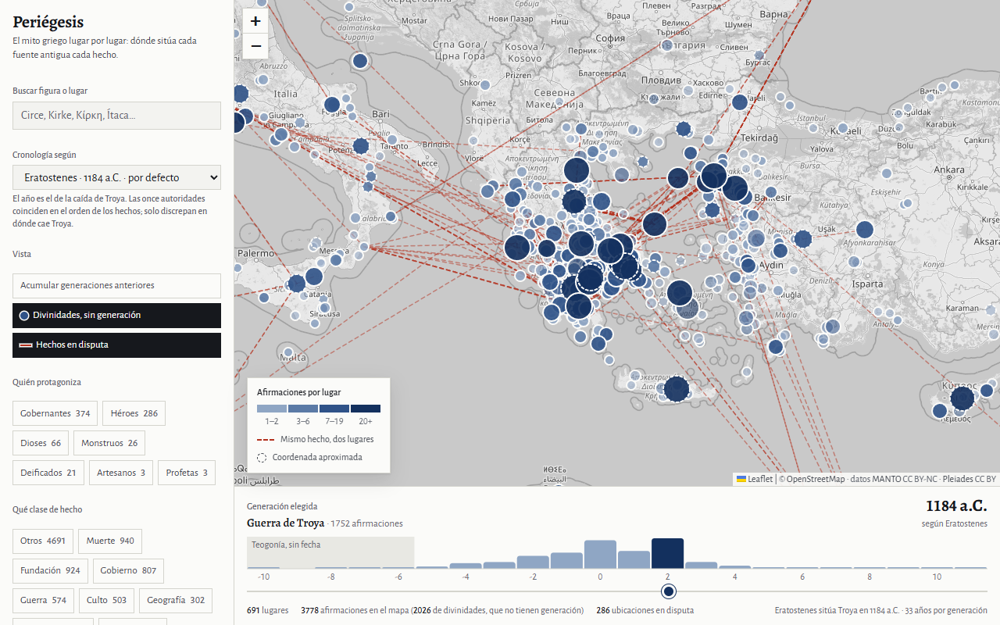
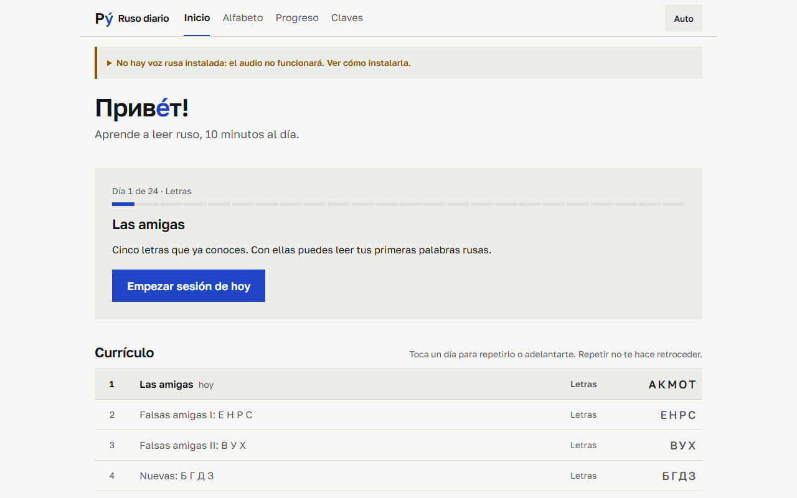
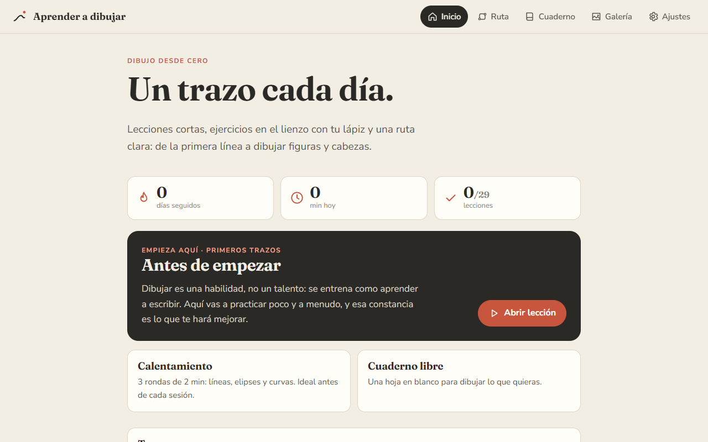

# Alfonso Massaguer

Datero en Madrid. Saco datos de donde estén (APIs, webs, datasets académicos), los meto en una base
de datos y les pongo encima una interfaz que se entienda. Últimamente, sobre todo, herramientas
para aprender cosas: mitología, ruso, dibujo, ganchillo.

## Periégesis — el mito griego, lugar por lugar

~9.000 entidades y ~32.000 relaciones de la mitología griega en SQLite, construidas a partir de
datasets académicos abiertos (MANTO, Pleiades, ToposText). Cada afirmación lleva su cita enlazada a
Perseus, y cuando dos fuentes sitúan el mismo hecho en sitios distintos se guardan las dos. La web
mueve el mapa generación a generación: en la +2 queda aislada la guerra de Troya.

[Abrir el mapa](https://alfonso-wav.github.io/greek_myth_map/) · [Código](https://github.com/Alfonso-wav/greek_myth_map) · Python, SQLite, Leaflet

## Apps para aprender

<table>
<tr>
<td width="50%" valign="top">

**[Ruso diario](https://alfonso-wav.github.io/ruso-diario/)** — Leer ruso en 10 minutos al día:
alfabeto, sesiones con ejercicios, teclado cirílico y repaso espaciado con FSRS.

</td>
<td width="50%" valign="top">

**[Aprender a dibujar](https://alfonso-wav.github.io/aprender-a-dibujar/)** — 29 lecciones para
tablet con lápiz, de la primera línea a la cabeza con el método Loomis. Funciona sin conexión.

</td>
</tr>
</table>

Y [Ganchillo desde cero](https://alfonso-wav.github.io/croche/): 16 lecciones de la cadeneta al
amigurumi, con contador de filas y un tema pantano.

## Más proyectos

- **[Otis](https://github.com/Alfonso-wav/otis)** — Pokédex, constructor de equipos y simulador de
  combates con cálculo de daño real. Go + TypeScript, escritorio y Android.
- **[Audio visualizer](https://github.com/Alfonso-wav/audio_viz2)** — Visualizadores de audio a
  partir de un enlace de YouTube, con vista previa en vivo y exportación a MP4. FastAPI, Celery, React, p5.js.
- **[Web scraper + SQL dashboard](https://github.com/Alfonso-wav/web-scraper-sql-dashboard)** —
  Scraping de Amazon y El Corte Inglés con Playwright, PostgreSQL y un dashboard con editor SQL.
- **[Mental health Spain](https://github.com/linama2593/mental_health_spain)** — Riesgo de
  depresión y ansiedad a partir de la Encuesta Nacional de Salud. En equipo.

## Con qué trabajo

Python, SQL (SQLite, PostgreSQL), pandas, scikit-learn, Playwright, Go, TypeScript y JavaScript sin
framework cuando basta. Me tiran el audio, los videojuegos y los datos medioambientales: si tienes
un proyecto donde los datos se cruzan con alguno de esos mundos, escríbeme.

[LinkedIn](https://www.linkedin.com/in/alfonso-massaguer) · [X @alfonso_wav](https://x.com/alfonso_wav) · 🐊
